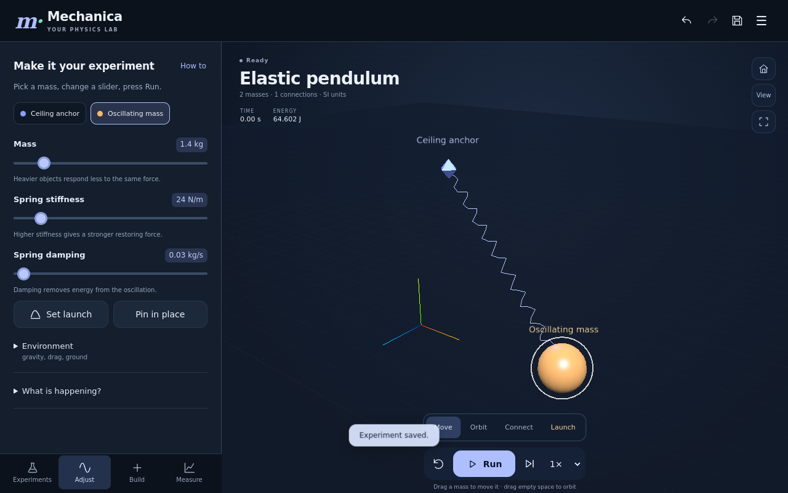

# Mechanica

Android mechanics simulation sandbox; V2 work in progress with V1 validation documented.

## Technology

JavaScript, Three.js, Android / Java and numerical mechanics.

## Source

The complete current source snapshot contains **51 files**, including its original folder structure and project documentation.

[Download complete source](mechanica-source.zip)

Extract the ZIP, then open the `mechanica/` folder. Its original `README.md` contains the project-specific setup and build instructions.

## Review

Representative source excerpts are available in [CODE_EXAMPLES.md](CODE_EXAMPLES.md). The excerpts are for review; use the complete source snapshot to build or run the project.

## Preview

V2 browser interface preview. This is not a verified Android-device screenshot.

## Scope and validation

The original project documentation, attribution, dependency notices and stated limitations are preserved inside the source snapshot. Existing validation evidence is retained; this repository upload does not imply new runtime or platform validation.

Private signing keys, local credentials and hosting metadata are excluded.
